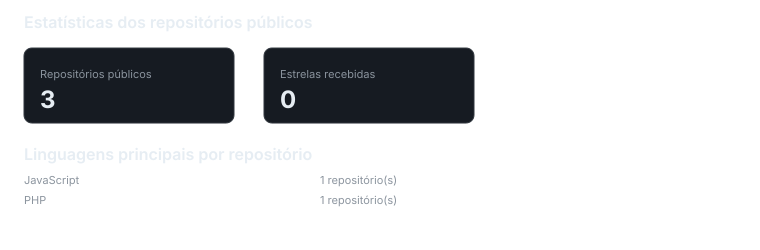
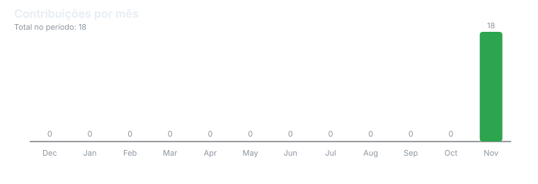

# Marcus Vinícius

<p align="center">
  <samp>DATA ENGINEERING · DATA ANALYST · DATA SCIENTIST</samp>
</p>

<p align="center">
  Desenvolvedor por curiosidade, solucionador de problemas por natureza.
</p>

<p align="center">
  <a href="https://github.com/kimvns" style="text-decoration:none;">
    
  </a>
  <a href="https://www.linkedin.com/in/kim-vns/" style="text-decoration:none;">
    
  </a>
</p>

---

## Sobre mim

```python
def about_me():
    return {
        "interesses": [
            "Desenvolvimento de software",
            "Engenharia e análise de dados",
            "Automação de processos"
        ],
        "objetivo": "Transformar problemas em soluções práticas",
        "filosofia": "Aprender, experimentar e evoluir"
    }
```

---

## Áreas de interesse

```python
def areas_of_interest():
    return {
        "data_engineering": [
            "Integração e processamento de dados",
            "ETL e Data Pipelines"
        ],
        "development": [
            "Aplicações e soluções backend",
            "Scripts e automação"
        ],
        "databases": [
            "Modelagem e consultas",
            "Gerenciamento de informações"
        ],
        "automation": [
            "Workflows",
            "Otimização de processos"
        ]
    }
```

---

## Tecnologias & Ferramentas

| CATEGORIA | TECNOLOGIAS |
|:---|:---|
| **Linguagens** |       |
| **Bancos de dados** |     |
| **Ciência de Dados** |       |
| **Infraestrutura** |     |
| **Orquestração & Monitoramento** |   |

---

## O que desenvolvo?

```python
def development_mindset():
    return {
        "data": "Coletar, processar e organizar informações",
        "automation": "Eliminar tarefas repetitivas",
        "engineering": "Construir soluções confiáveis",
        "development": "Transformar ideias em aplicações",
        "mindset": "Aprender, experimentar e evoluir"
    }
```

---

## GitHub Analytics

<p align="center">
  
</p>

---

## Contribution Activity

<p align="center">
  
</p>

<p align="center">
  
</p>

---

## Conecte-se comigo

<p align="left">
  <a href="https://www.linkedin.com/in/kim-vns/">
    
  </a>
  <a href="mailto:kim.only3d@gmail.com">
    
  </a>
</p>

---

<p align="center">
  <samp>Construindo soluções, aprendendo todos os dias.</samp>
</p>
